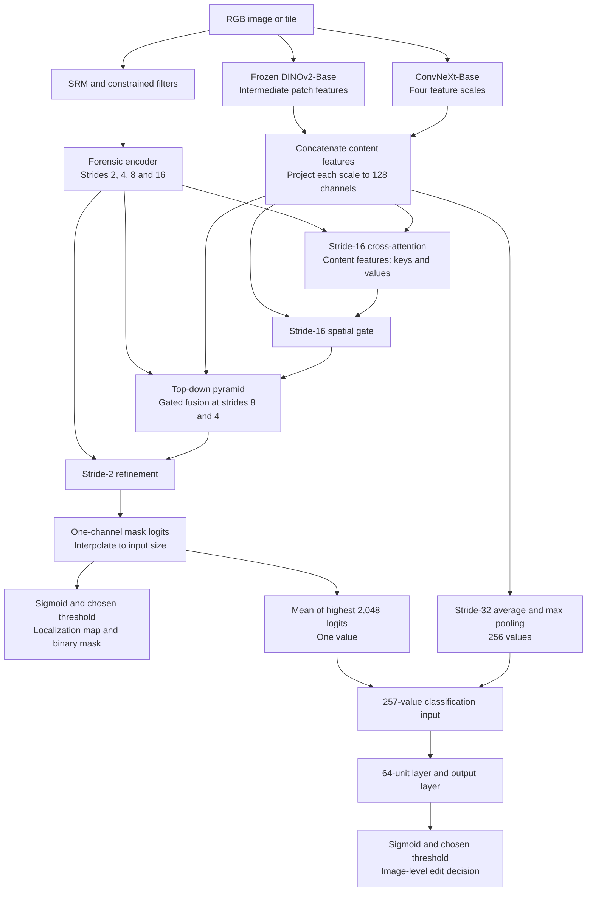
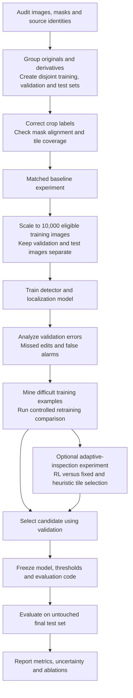

# Detection and Localization of AI-Inpainted Image Regions

**Technical progress note | 14 November 2026**

## 1. Research objective

The study examines whether image content features and forensic residual features can jointly detect localized AI edits and identify their spatial extent. The intended input is a single RGB image. The outputs are an image-level edit score and a pixel-level localization map. An unedited reference image is not required during inference. Binary edit masks are required for training the localization component and for evaluating its predictions.

The present scope is AI inpainting: replacement or removal of part of an image. Detection of all image manipulations, identification of the editing system, and distinction between AI edits and conventional retouching are separate questions that have not yet been established by these experiments.

## 2. Implemented model variants

The descriptive identifiers below distinguish the implemented architectures without assigning a new method name.

| Variant | Image content encoders | Forensic features | Fusion |
|---|---|---|---|
| Initial convolutional model | ConvNeXt-Tiny | SRM and constrained convolution residuals | Feature pyramid decoder |
| Dual-encoder model | ConvNeXt-Small and frozen DINOv2-Small | Same residual feature family | Spatially gated feature pyramid |
| Current model | ConvNeXt-Base and frozen DINOv2-Base | Same residual feature family | Cross-attention at stride 16, followed by gated pyramid fusion |

The current model is the main development candidate. Existing checkpoints were trained on a small development dataset; the proposed 10,000-image training experiment and reinforcement-learning extension have not been completed.

## 3. Current architecture

### Image content branches

**ConvNeXt-Base** uses ImageNet-pretrained weights and produces feature maps at strides 4, 8, 16 and 32, with 128, 256, 512 and 1,024 channels respectively. The first two stages are frozen in the default configuration; the later stages are trainable.

**DINOv2-Base/14** provides 768-dimensional patch features. All its weights remain frozen. Intermediate outputs from transformer blocks indexed 2, 5, 8 and 11 are interpolated to the four pyramid resolutions. These are resampled transformer features, rather than independently learned high-resolution feature maps. Input dimensions are padded to multiples of 14 before feature extraction.

### Forensic branch

The forensic branch combines 30 fixed SRM high-pass filter responses with 30 learnable constrained convolution responses. A convolutional encoder converts these residuals into features at strides 2, 4, 8 and 16, with 48, 96, 144 and 192 channels. This branch is intended to capture local statistical irregularities. Its responses are learned evidence, not a unique signature proving that an image was generated or edited by AI.

### Feature fusion and localization

At each content-pyramid level, the ConvNeXt and DINOv2 features are concatenated and projected to 128 channels. Forensic features are also projected to 128 channels.

At stride 16, an eight-head cross-attention block uses forensic features as queries and content features as keys and values. Residual connections and a feed-forward layer follow attention. A learned gate then combines the attended features with the content representation. Strides 8 and 4 use spatial gates without additional cross-attention blocks.

A top-down feature pyramid carries coarse information to finer resolutions. At stride 2, the decoder incorporates the finest forensic features, reduces the representation to 64 channels, and applies a one-channel convolution. Bilinear interpolation restores the output to the input dimensions. Applying a sigmoid gives the localization score at each pixel. A binary mask requires a separately specified threshold.

### Image-level decision

The classification head receives a 257-dimensional vector consisting of:

1. Global average pooling of the 128-channel stride-32 content representation.
2. Global maximum pooling of the same representation, producing another 128 values.
3. The mean of the highest 2,048 localization logits, or all pixels when fewer are available.

A fully connected layer with 64 units, GELU activation, dropout of 0.2, and a final linear layer produces one classification logit. Its sigmoid is an edit score; calibration must be assessed before interpreting it as a reliable probability.

```text
RGB image
   ├── ConvNeXt-Base ──┐
   ├── DINOv2-Base ────┴── Content feature pyramid ──┐
   └── Residual filters ── Forensic feature pyramid ─┤
                                                   ↓
                         Cross-attention and spatial gates
                                                   ↓
                             Pyramid decoder and refinement
                                                   ↓
                                          Localization map

Coarse content features + strongest localization logits
                         ↓
                 Image classification head
```

## 4. Existing training procedure

The recorded current-model run used 1,140 training images and 280 validation images from a multi-generator development manifest. Training used 384 × 384 random crops, horizontal flips, a batch size of 2 and 1,200 optimizer steps. This is a preliminary training run, not evidence of convergence at dataset scale.

The implemented objective is:

`L = L_segmentation + 0.5 L_classification + 0.3 L_background`

For records labeled edited, the segmentation term combines class-balanced pixel binary cross-entropy and Dice loss. The classification term is binary cross-entropy on the classification logit. For genuine-image records, the background term penalizes the mean predicted edit probability. Optimization uses AdamW, learning rates of 0.00005 for selected backbone parameters and 0.0002 for new layers, cosine scheduling, and gradient-norm clipping at 1.0.

The existing validation loader uses center crops when images are sufficiently large. This differs from whole-image and tiled evaluation and is being treated as a protocol limitation.

## 5. Preliminary observations

The figures below describe the previously inspected 100-image development set. They are not independent final-test estimates and should not be compared directly with published full-benchmark results.

| Configuration and measurement | Recorded value |
|---|---:|
| Current model, raw mean localization IoU | 33.55% |
| Current model, tiny-edit IoU | 7.91% on five examples |
| Current model, image AUROC from pooled localization scores | 0.6432 |
| Current model, calibrated whole-image/local-score combination accuracy | 67/100 |
| Two-model ensemble with flip augmentation, mean localization IoU | 34.99% |

These rows use different scoring or inference configurations and must not be presented as one model operating at a single fixed setting. On the 20-image SDXL development subset, an alternative tile-scoring rule increased correct decisions from 10 to 11; all six missed edited images remained missed. Changing the score aggregation alone therefore did not resolve those misses.

## 6. Problems requiring correction

**Crop targets.** The current loader retains the full-image classification label after cropping. A crop can contain no annotated edited pixels but still receive a positive target. A sampling audit using seed 42 and 20 random crops per edited training image found this in 4,285 of 16,200 crops (26.45%). This is an estimate from simulated sampling, not a reconstruction of the historical batches. The validation center crop omitted the annotated edit in 35 of 210 edited records. Local crop targets and whole-image targets need separate definitions.

**Collection imbalance.** The additional SDXL, SD2.1, SD3 and FLUX training records are edited images, while genuine records come from the initial collection. Source and processing differences may therefore correlate with the class label. This is a possible confound, not a demonstrated explanation for every error.

**Evaluation independence.** Repeated inspection of the same development images limits their value as a final test. Source originals, edited derivatives and near-duplicates must be grouped before splitting. Exact file-hash separation alone does not establish source independence.

**Attribution of improvement.** Backbone size and fusion design changed together between model versions. The existing results do not isolate the effect of cross-attention. A controlled comparison with fixed backbones and training conditions is required.

## 7. Planned experiments

First, correct crop targets and validation coverage, then compare the corrected model with the existing training procedure under matched data and compute. Next, scale to a target of 10,000 eligible training images, provisionally balanced between genuine and edited examples, with separate source-disjoint validation and test sets. The actual count, provenance, masks and preprocessing must be documented before training.

Native-resolution patches will retain local detail, while a whole-image view will provide context. Training will include small edits and difficult genuine examples. Tile selection at inference must not use reference masks. Error analysis will separate missed edits from false alarms and report results by edit size, generator and image quality.

Reinforcement learning is a later experiment for choosing the next region to inspect or deciding when to stop under a fixed inspection budget. It will be compared with grid, random and confidence-based selection using the same detector and compute allowance. Retraining on difficult labeled examples is ordinary label-based learning and will be reported separately.

The paper will report image accuracy, F1, AUROC and false-positive rate alongside localization IoU and pixel F1, with explicit thresholds, sample counts and uncertainty estimates. Single-generator and multi-generator training will be evaluated separately. No claim of novelty or leading performance is established by the current results.

## 8. Comparative experimental results

The following comparison uses the saved calibrated-score report. All rows refer to the same previously inspected 100-image development subset. The report's internal name for this subset is retained in the source file, but it is not treated here as an independent final test. Accuracy and F1 are percentages; AUROC is on a 0–1 scale. F1 and AUROC are the overall values in the report, not averages of generator-specific metrics.

| Architecture | Edited-image training exposure | Evaluation score | Accuracy | Image F1 | AUROC |
|---|---|---|---:|---:|---:|
| Dual-encoder model: ConvNeXt-Small + DINOv2-Small | SD1.5 only | Calibrated whole-image/local combination | 63.00 | 65.42 | 0.6592 |
| Dual-encoder model: ConvNeXt-Small + DINOv2-Small | Multiple generators | Calibrated whole-image/local combination | 60.00 | 57.45 | 0.7272 |
| Current model: ConvNeXt-Base + DINOv2-Base, cross-attention | Multiple generators | Calibrated whole-image/local combination | 67.00 | 65.26 | 0.6900 |

The current model has the highest accuracy among these configurations, while the smaller multi-generator model has the highest AUROC. The results therefore do not establish that one architecture is best on every criterion. Training exposure also differs between rows.

The combination is `s = alpha × s_whole + (1 − alpha) × s_local`. The recorded calibration settings are alpha = 0.10 and threshold = 0.9274 for the SD1.5-only model; alpha = 0 and threshold = 0.9794 for the smaller multi-generator model; and alpha = 0.15 and threshold = 0.9358 for the current model. With alpha = 0, the combination reduces to the local score. These settings must be retained when reproducing the table.

Source: `controlled_localization/reports/calibrated_fused_protocol_results.json`. Comparisons with published methods require a separate matched-protocol evaluation; the table does not establish a ranking against those methods.

## 9. Current-model inference flowchart

This diagram describes one forward pass. The same network can process a whole-image view or a native-resolution tile. Tiled evaluation requires an additional, explicitly defined overlap-merging and image-score aggregation procedure.



Forensic features provide the queries in the stride-16 attention block. The diagram separates the classification head from the localization head because their outputs require different evaluation metrics and thresholds.

## 10. Planned experimental workflow



Only the data preparation, existing small-scale training and development evaluations have been performed so far. The 10,000-image run, corrected-training comparisons and adaptive-inspection study remain planned. Final test results must not feed back into model selection or training.

## 11. Evidence and reproducibility

This note is based on the local implementation and recorded development results. Architecture details were checked against the current detector, attention decoder and DINOv2 encoder; the objective was checked against the training and segmentation-loss implementations.

Relevant project records are `FDDM_Research_Flow_and_Log.txt`, `controlled_localization/reports/sdxl_error_audit/scores.json`, and `GEMINI_10000_IMAGE_TRAINING_HANDOFF.txt`. Subsequent experiments should preserve code revisions, manifests, configurations, checkpoint hashes and per-image predictions so that each reported number can be reproduced.

## 12. Literature comparison: detection accuracy and publication venue

Accuracy below is average image-level detection accuracy across five OpenSDID generators at threshold 0.5, as reported in [FUSED, Table 2](https://arxiv.org/html/2608.28302v1). It is not localization accuracy or necessarily a number reported in each method's original paper. FUSED reports training these methods on SD1.5 only. Venue identifies the original method publication; benchmark results are attributed to FUSED's evaluation.

| Method | Original publication venue | Average detection accuracy (%) |
|---|---|---:|
| FUSED | arXiv preprint, 2026; conference/journal publication not verified | 89.5 |
| MaskCLIP | CVPR 2025, OpenSDI paper | 82.0 |
| RINE | ECCV 2024 | 80.3 |
| PSCC-Net | IEEE TCSVT 2022 | 76.8 |
| NPR | CVPR 2024 | 76.4 |
| CAT-Net | IJCV 2022, journal version cited in the benchmark | 76.2 |
| UniFD | CVPR 2023 | 75.7 |
| MVSS-Net | IEEE TPAMI, online 2022 | 75.1 |
| DeCLIP | WACV 2025 | 73.1 |
| GramNet | CVPR 2020 | 72.3 |
| CNNDetection | CVPR 2020 | 70.9 |
| TruFor | CVPR 2023 | 69.8 |
| ObjectFormer | CVPR 2022 | 66.3 |
| FreqNet | AAAI 2024 | 66.3 |
| IML-ViT | arXiv 2023; venue unverified for this paper | 56.4 |

Venue references: [FUSED record](https://arxiv.org/abs/2608.28302), [MaskCLIP/OpenSDI proceedings](https://openaccess.thecvf.com/content/CVPR2025/html/Wang_OpenSDI_Spotting_Diffusion-Generated_Images_in_the_Open_World_CVPR_2025_paper.html), [RINE proceedings](https://www.ecva.net/papers/eccv_2024/papers_ECCV/html/9160_ECCV_2024_paper.php), [DeCLIP proceedings](https://openaccess.thecvf.com/content/WACV2025/html/Smeu_DeCLIP_Decoding_CLIP_Representations_for_Deepfake_Localization_WACV_2025_paper.html). Other venue details follow the cited method references in the FUSED bibliography. Publication status checked on 14 November 2026.

### Local result, shown separately

| Model | Publication status | Local detection accuracy | Evaluation scope |
|---|---|---:|---|
| Current cross-attention model | Unpublished research in progress | 67.0% | Previously inspected 100-image development subset; multi-generator training; calibrated threshold |

The local result is not directly comparable with the literature table because training exposure, evaluation sample and threshold policy differ. It cannot establish a performance gap or a ranking against published methods. A matched-protocol evaluation remains necessary.
